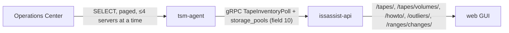

# Tape mission v1.2 part 2: tsmAgent.tapeSync.concurrency

## Summary

One key, `tsmAgent.tapeSync.concurrency` (default 4). It becomes `IA_TAPE_SYNC_CONCURRENCY`
on the tsm-agent and caps how many servers the tape sync asks at once, per Operations
Center.

## Cross-repo overview

Mission IssTech/IssAssist-Mission #225, v1.2 part 2. Part 1 (2026/10/21) made ranges save
and showed what each server answered. Part 2 builds the rest of the Tapes page agreed in
the v1.0 and v1.1 mockups, and makes the sync cheaper on a large estate. The mockup was
approved on 2026/10/22: `issassist-webgui/docs/mockups/2026-10-22-tape-v1-2-part2/index.html`.

Built on one rule from the user: **everything is asked through the Operations Center,
never a server directly**, and nothing executes a tape-handling command.

| Repo | Role | Branch | README |
|---|---|---|---|
| issassist-tsm-agent | Sync: paging, manager-only inventory, fan-out cap, daily topology, storage pools | `rfe/tape-v1-2-part2-20261022` | `docs/projects/2026-10-22-tape-v1-2-part2.md` |
| issassist-api | Health, guide, gaps/watermark, outlier answers, change log, paged list, migration v2.41.0 | same | same path |
| issassist-webgui | Filters, scratch strip, Health column, row menu, paging, outliers, change log | same | same path |
| issassist.helm | `tsmAgent.tapeSync.concurrency` | same | same path |

## What changed in this repo

- `values.yaml`: `tsmAgent.tapeSync.concurrency: 4`.
- `templates/issassist/tsm-agent/deployment.yaml`: renders the env var, reading the key
  through `default dict` so that an upgrade with `--reuse-values` (old values, no
  `tapeSync`) still renders. The agent then uses its own default of 4.

## How to verify

- `helm template`: the only difference from `review` is the two env lines.
- It renders with `tapeSync: null`.
- `helm lint` fails with "missing dependency kubernetes-secret-generator", exactly as on
  `review`; this change does not cause it.

## Deployment & rollback

Rolls back with the release; the agent default is the same value.

## Known limitations & follow-ups

None.

## Commits

See the PR.
